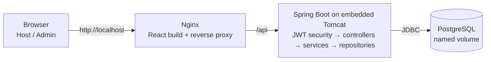

# Containerized Homestay Host Management Platform

A small web application that helps homestay hosts manage properties, rooms, guests and bookings in one place, prevents double-bookings, tracks check-in/check-out and payment status, and shows a daily dashboard.

> **Project status:** repository initialised (Task 4). Only the application skeleton exists: it builds, starts and answers a health check. MVP features are built in Sprints 1–3.

## Overview

- **What it does:** keeps every property, room, guest and booking record in one database and checks room availability automatically.
- **Who it is for:** independent homestay hosts and small property managers (primary user), plus an administrator who manages host accounts.
- **What problem it solves:** hosts today keep records across notebooks, spreadsheets and chat messages, which leads to double-bookings, unclear payment status and no quick overview of the day.

This is a host-side management tool, **not** a public booking marketplace: guests do not log in or book online.

## MVP Features

The MVP is frozen at 15 tasks (Task 1). Status: all **planned**.

| ID | Feature |
| --- | --- |
| MVP-01 | User login and logout |
| MVP-02 | Role-based access (Admin, Host) and host account management |
| MVP-03 | Create and list properties |
| MVP-04 | Update and delete a property |
| MVP-05 | Add and list rooms under a property |
| MVP-06 | Update, deactivate and delete rooms |
| MVP-07 | Check room availability for a date range |
| MVP-08 | Create and update guest records |
| MVP-09 | Search guests and view guest history |
| MVP-10 | Create a booking |
| MVP-11 | Prevent double-booking |
| MVP-12 | View and filter bookings |
| MVP-13 | Update booking and payment status |
| MVP-14 | Host dashboard summary |
| MVP-15 | Dockerise the application |

**Out of scope:** online payments, guest portal or app, marketplace listings, channel-manager integration, AI or dynamic pricing, reviews, chat, maps, notifications, staff roles, cloud hosting.

## Technology Stack

| Layer | Technology |
| --- | --- |
| Frontend | React + Vite, served by Nginx *(added in Sprint 1)* |
| Backend / API | Java 21, Spring Boot 4.1, REST/JSON |
| Security | Spring Security, JWT, BCrypt *(Sprint 1)* |
| Database | PostgreSQL 17, Spring Data JPA, Flyway *(Sprint 1)* |
| Build tool | Maven (Maven Wrapper included) |
| Testing | JUnit (Jupiter), Spring Boot Test; Mockito, MockMvc and Testcontainers added with features |
| Application server | Embedded Apache Tomcat (inside Spring Boot) |
| Reverse proxy | Nginx *(MVP-15)* |
| Containers | Docker + Docker Compose *(MVP-15)* |
| CI/CD | GitHub Actions + GitHub Container Registry *(planned)* |

## Architecture

A modular monolith: one Spring Boot application with feature modules, each split into controller, service and repository layers.



Only the Spring Boot part exists today. Nginx, React and PostgreSQL are added as the MVP tasks that need them are built.

## Project Structure

```text
homestay-host-management-platform/
├── .github/
│   ├── ISSUE_TEMPLATE/        bug report, user story and task templates
│   └── pull_request_template.md
├── backend/                   Spring Boot application (Maven)
│   ├── .mvn/wrapper/          Maven Wrapper settings
│   ├── mvnw, mvnw.cmd         Maven Wrapper scripts (Linux/macOS, Windows)
│   ├── pom.xml                build file
│   └── src/
│       ├── main/java/com/homestay/HomestayApplication.java
│       ├── main/resources/application.properties
│       └── test/java/com/homestay/HealthEndpointTest.java
├── docs/                      architecture and Git workflow notes
├── .env.example               configuration placeholders (copy to .env)
├── .gitattributes             line-ending rules for Windows and Linux
├── .gitignore
├── LICENSE
└── README.md
```

`frontend/`, `Dockerfile`s, `docker-compose.yml` and `.github/workflows/` are added by the tasks that need them (Sprint 1 and MVP-15).

## Prerequisites

| Software | Version |
| --- | --- |
| JDK | 21 (Eclipse Temurin recommended) |
| Git | 2.x |
| Maven | not required — use the included `mvnw` / `mvnw.cmd` |
| IDE | IntelliJ IDEA Community or VS Code with the Java Extension Pack |
| Docker Desktop | current release *(needed from Sprint 1 for PostgreSQL)* |
| Node.js | current LTS *(needed from Sprint 1 for the frontend)* |

## Local Setup

Windows 11, PowerShell:

```powershell
# 1. Clone
git clone <REPOSITORY_URL>
cd homestay-host-management-platform

# 2. Configure environment (placeholders only for now; used from Sprint 1)
Copy-Item .env.example .env

# 3. Install dependencies and build (first run downloads Maven and libraries)
cd backend
.\mvnw.cmd clean package

# 4. Start the database  -> planned for Sprint 1 (PostgreSQL in Docker)

# 5. Run the application
.\mvnw.cmd spring-boot:run

# 6. Run tests (in a second terminal, or after stopping the app with Ctrl+C)
.\mvnw.cmd test
```

On Linux or macOS use `./mvnw` instead of `.\mvnw.cmd`.

## API / Application Access

| What | URL | Available |
| --- | --- | --- |
| Health check | http://localhost:8080/actuator/health | Now |
| REST API base | http://localhost:8080/api | From Sprint 1 |
| Web application (dev server) | http://localhost:5173 | From Sprint 1 |
| Web application (Docker, via Nginx) | http://localhost | After MVP-15 |

Expected health response:

```json
{"status":"UP"}
```

The health endpoint only proves the application is running. It is not the host dashboard (MVP-14).

## Testing

```powershell
cd backend
.\mvnw.cmd test
```

Expected: `Tests run: 1, Failures: 0, Errors: 0, Skipped: 0` and `BUILD SUCCESS`.

## Docker

**Planned (MVP-15, Sprint 1).** The target is three containers — `nginx`, `backend`, `postgres` — started with:

```powershell
docker compose up --build
```

This does not work yet: no Dockerfile or Compose file exists in the repository.

## Branching Strategy

- `main` — always working; receives code only through pull requests from `develop` at the end of each sprint.
- `develop` — integration branch; every feature is merged here through a pull request.
- Short-lived work branches from `develop`: `feature/<short-description>`, `fix/<short-description>`, `docs/<short-description>`, `test/<short-description>`, `chore/<short-description>`.

Branch names are lowercase and hyphen-separated, e.g. `feature/property-management`, `fix/booking-validation`.

Details: [docs/git-workflow.md](docs/git-workflow.md).

## Contribution Guidelines

1. Pick an issue from the project board and assign it to yourself.
2. Create a branch from `develop` using the naming rules above.
3. Commit using `type: short description` (e.g. `feat: add booking creation endpoint`).
4. Run `.\mvnw.cmd test` before pushing.
5. Open a pull request into `develop`, fill in the template and ask one team member to review.
6. Never commit `.env`, passwords, keys or database credentials.

## License

[MIT](LICENSE)
